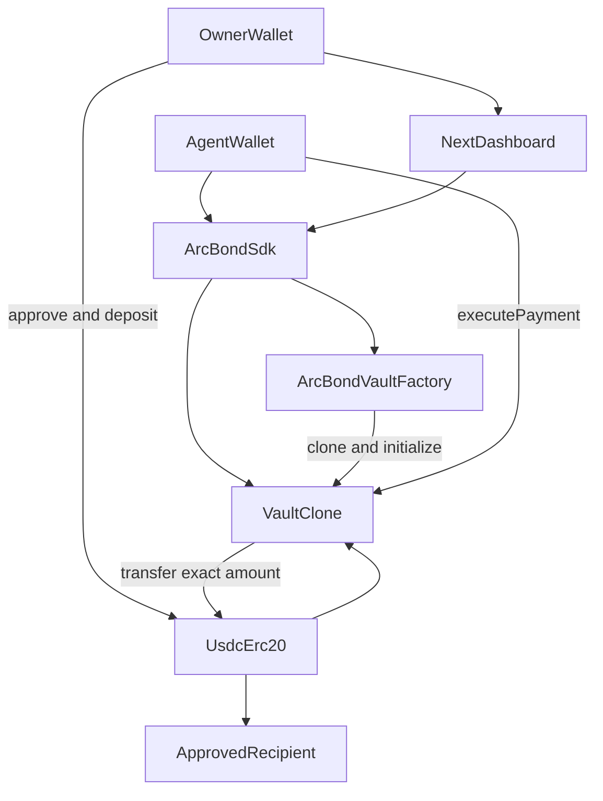
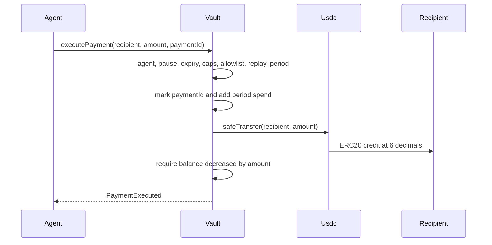

# ArcBond Architecture

ArcBond is an on-chain authorization layer for USDC payments on Arc. Humans define policy. An authorized agent may request a payment. The vault contract is the only security boundary.

## Why clones, not a shared manager

The MVP uses per-user EIP-1167 clones of one immutable implementation, created by an ownerless factory.

A shared vault manager would keep every user's USDC at one address. One accounting bug could spend one user's funds for another. Clones share logic, so a logic bug still affects every vault, but each vault's spendable funds are that clone's own ERC-20 `balanceOf`. There is no internal share ledger.

Arc gas is USDC and the documented design target is about $0.001 per ERC-20 transfer, so a clone deployment is acceptable.

There is no proxy admin and no upgrade function. A defective deployment is abandoned by withdrawing to a newly created vault.

## System diagram



## Payment sequence



## Components

| Component | Role |
| --- | --- |
| `ArcBondVault` implementation | Immutable logic. Constructor disables `initialize` and requires USDC `decimals() == 6`. |
| `ArcBondVaultFactory` | Ownerless. Stores the implementation, clones it, and calls `initialize(msg.sender)` in the same transaction. |
| Vault clone | Holds that owner's USDC and policy. |
| Next.js dashboard | Wallet UX. Never the enforcement layer. |
| TypeScript SDK | Encodes, simulates, and submits calls with the caller's wallet. |
| `scripts/agent-pay.ts` | Demo agent. Signs with `AGENT_PRIVATE_KEY` only. |

There is no backend and no indexer. Vault discovery uses `VaultCreated` plus `factory.vaultsOf(owner)` and `factory.isVault(address)`.

## USDC handling

See [ARCBOND_NETWORK_CONFIGURATION.md](ARCBOND_NETWORK_CONFIGURATION.md).

- `USDC` is a constant: `0x3600000000000000000000000000000000000000`.
- All vault functions are nonpayable. No `receive`, no fallback.
- Deposit is `transferFrom` after `approve`.
- Native transfers to the vault revert, which avoids 18-decimal dust that `balanceOf` truncates.
- `executePayment` transfers USDC and returns. It does not call the recipient.
- Spendable funds are `USDC.balanceOf(address(this))`.

## Roles

| Role | Can | Cannot |
| --- | --- | --- |
| Owner | Set policy, recipients, agent, pause, unpause, withdraw, two-step transfer ownership | Be the agent |
| Agent | `executePayment`, and sign an EIP-712 payment intent | Change policy, add recipients, withdraw, pause, authorize itself |
| Anyone | `deposit` | Gain authority by depositing |
| Factory | Create clones | Withdraw, pause, upgrade, or own vaults |

Ownership is two-step and local to the vault. The factory is not an admin.

## Policy and period

One policy set per vault:

- `maxPerPayment` — a zero cap rejects every payment.
- `periodLimit` — a zero cap rejects every payment.
- `PERIOD` is the constant `1 days` (86,400 seconds).
- `periodId = block.timestamp / PERIOD` (UTC day). When the id changes, `spentInPeriod` resets.
- Spending the full cap just before and just after 00:00 UTC is allowed. The UI must say that.
- Recipient allowlist. Empty allowlist rejects every payment. `address(0)` and the vault cannot be approved.
- One agent and `expiresAt`. Payment requires `block.timestamp < expiresAt`.
- `bytes32 paymentId` is unique per vault, never pruned, and must be non-zero.

Policy updates do not reset `spentInPeriod` or clear payment ids. Revoke sets agent and expiry to zero immediately and does not need the agent key. Authorizing a new agent replaces the old one. There is no on-chain expiry maximum; the UI warns above 90 days.

## `executePayment` order

All checks are on-chain:

1. Reentrancy guard.
2. Not paused.
3. `msg.sender == agent` and agent is non-zero.
4. `block.timestamp < expiresAt`.
5. Amount is non-zero and `<= maxPerPayment`.
6. Recipient is approved.
7. `paymentId` is non-zero and unused in this vault.
8. Refresh the period window, then require `spentInPeriod + amount <= periodLimit`.
9. Mark the id and increase `spentInPeriod` before the token call.
10. `safeTransfer` the exact amount. Require `balanceOf` decreased by exactly that amount.

Any shortfall, revert, or blocklist failure rolls back the whole transaction.

`executePaymentIntent` is the signed path. A relayer may submit it. The contract recovers the signer, requires that signer to be the current agent, and then applies the same spending rules. The signed fields, nonce, deadline, and policy version are specified in [INTENT_PAYMENTS.md](INTENT_PAYMENTS.md). `executePayment` remains the direct agent-sender path. It does not accept an EIP-712 signature. A compromised agent key can use either path inside the current policy.

`withdraw` is owner-only, works while paused, uses the same exact-balance check, and is unavailable to the agent.

## Interface

```solidity
interface IArcBondVault {
    function deposit(uint256 amount) external;
    function withdraw(uint256 amount) external;
    function updatePolicy(uint256 maxPerPayment, uint256 periodLimit, uint64 expiresAt) external;
    function setRecipient(address recipient, bool approved) external;
    function authorizeAgent(address agent) external;
    function revokeAgent() external;
    function executePayment(address recipient, uint256 amount, bytes32 paymentId) external;
    function pause() external;
    function unpause() external;
    function transferOwnership(address newOwner) external;
    function acceptOwnership() external;
}
```

## Events and errors

Events: `VaultCreated`, `Deposited`, `Withdrawn`, `PolicyUpdated`, `RecipientUpdated`, `AgentAuthorized`, `AgentRevoked`, `Paused`, `Unpaused`, `PaymentExecuted` (agent, recipient, amount, payment id, period id, spent total), `PaymentIntentExecuted`, `PolicyVersionChanged`, plus ownership events.

Custom errors include `UnauthorizedAgent`, `AuthorizationExpired`, `AmountExceedsLimit`, `PeriodLimitExceeded`, `RecipientNotApproved`, `PaymentIdUsed`, `VaultPaused`, `TransferAmountMismatch`, `InvalidTokenDecimals`, `AlreadyInitialized`, `InvalidOwner`, `InvalidAgent`, `InvalidRecipient`, `ZeroAmount`, `ZeroPaymentId`, `InvalidSignature`, `IntentExpired`, `WrongVault`, `WrongToken`, `PolicyVersionMismatch`, and `InvalidNonce`.

## Frontend

Vite + React in `apps/web`, wagmi + viem. When `NEXT_PUBLIC_PRIVY_APP_ID` is set, Privy opens one wallet modal and drives the wagmi connectors. Without it, the app uses a single injected connector and does not call `wallet_requestPermissions` before `eth_requestAccounts`. WalletConnect is enabled only when `NEXT_PUBLIC_WALLETCONNECT_PROJECT_ID` is set.

Writes require chain ID `5042` (or the configured chain). Wrong network blocks every write and offers add-or-switch to Arc. `maxFeePerGas` is at least 20 Gwei and at least the queried fee.

Pages: Overview, Vaults, Policy, Agents, Activity, Docs. No control is decorative. No fabricated balances or hashes. Intent signing lives in the Agent SDK.

## Known limits

- Fixed UTC windows can permit two caps across one boundary.
- Payment ids are never reused and are not pruned.
- A lost owner key bricks that vault.
- A compromised agent can spend whatever the current policy still allows.
- Owner compromise can change policy and withdraw.
- Sub-atomic native dust forced in by another contract can sit outside the 6-decimal view.
- The contract does not use `SELFDESTRUCT`, `PREVRANDAO`, or value-bearing calls.
- Rejected payments do not persist an on-chain event.
